# Wazuh SIEM Home Lab

A hands-on Security Information and Event Management (SIEM) home lab built using Wazuh, Ubuntu 22.04 and Windows 11 to monitor endpoint activity and detect file integrity changes.

## Project Overview

This project demonstrates the deployment of a Wazuh SIEM environment with an Ubuntu-based Wazuh server and a Windows 11 endpoint agent.

The lab uses File Integrity Monitoring (FIM) to detect file creation, modification and deletion events on a monitored Windows directory. The generated security alerts are collected and investigated through the Wazuh Dashboard.

## Objectives

- Deploy an all-in-one Wazuh SIEM environment.
- Integrate a Windows 11 endpoint with the Wazuh server.
- Configure real-time File Integrity Monitoring.
- Detect file creation, modification and deletion.
- Investigate security events through the Wazuh Dashboard.
- Understand endpoint monitoring and security alert analysis.

## Lab Environment

| Component | Configuration |
|---|---|
| SIEM Platform | Wazuh 4.14.9 |
| Server OS | Ubuntu 22.04.5 LTS |
| Endpoint OS | Windows 11 |
| Virtualization | Oracle VirtualBox 7.2 |
| Monitoring | File Integrity Monitoring (FIM) |
| Network | NAT and Host-Only Adapter |

## Architecture

The lab consists of an Ubuntu virtual machine hosting the Wazuh server components and a Windows 11 endpoint running the Wazuh agent.

**Architecture flow:**

```text
          Windows 11 Endpoint
          ┌──────────────────┐
          │   Wazuh Agent    │
          │                  │
          │  Monitored Files │
          └────────┬─────────┘
                   │
                   │ Security Events
                   ▼
          ┌──────────────────┐
          │  Ubuntu Server   │
          │                  │
          │  Wazuh Manager   │
          │  Wazuh Indexer   │
          │  Filebeat        │
          │  Wazuh Dashboard │
          └────────┬─────────┘
                   │
                   ▼
          ┌──────────────────┐
          │ Wazuh Dashboard  │
          │                  │
          │ Alert Monitoring │
          │ Event Analysis   │
          └──────────────────┘
```

## Implementation

### 1. Wazuh Server Deployment

- Installed Ubuntu 22.04.5 LTS in Oracle VirtualBox.
- Deployed the all-in-one Wazuh installation.
- Verified that Wazuh Manager, Indexer, Filebeat and Dashboard services were running.

### 2. Windows Endpoint Integration

- Installed the Wazuh agent on Windows 11.
- Connected the endpoint to the Ubuntu Wazuh server.
- Verified that the Windows agent appeared as Active in the Wazuh Dashboard.

### 3. File Integrity Monitoring

Configured the following Windows directory for real-time monitoring:

```text
C:\Users\athar\Wazuh-FIM-Test
```

The following experiments were performed:

| Test | Activity | Result |
|---|---|---|
| Test 1 | Created a new file | File addition detected |
| Test 2 | Modified the file contents | Checksum change detected |
| Test 3 | Deleted the file | File deletion detected |

## Experimental Results

Wazuh successfully generated alerts for all three FIM experiments.

| Activity | Wazuh Alert | Severity |
|---|---|---|
| File Creation | File added to the system | Level 5 |
| File Modification | Integrity checksum changed | Level 7 |
| File Deletion | File deleted | Level 7 |

## Screenshots and Evidence

The `Screenshots` directory contains evidence collected during the lab setup and experiments.

### Dashboard Overview

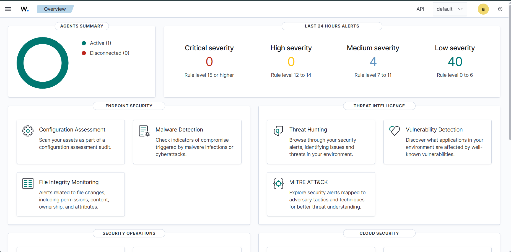

### Windows Agent Verification

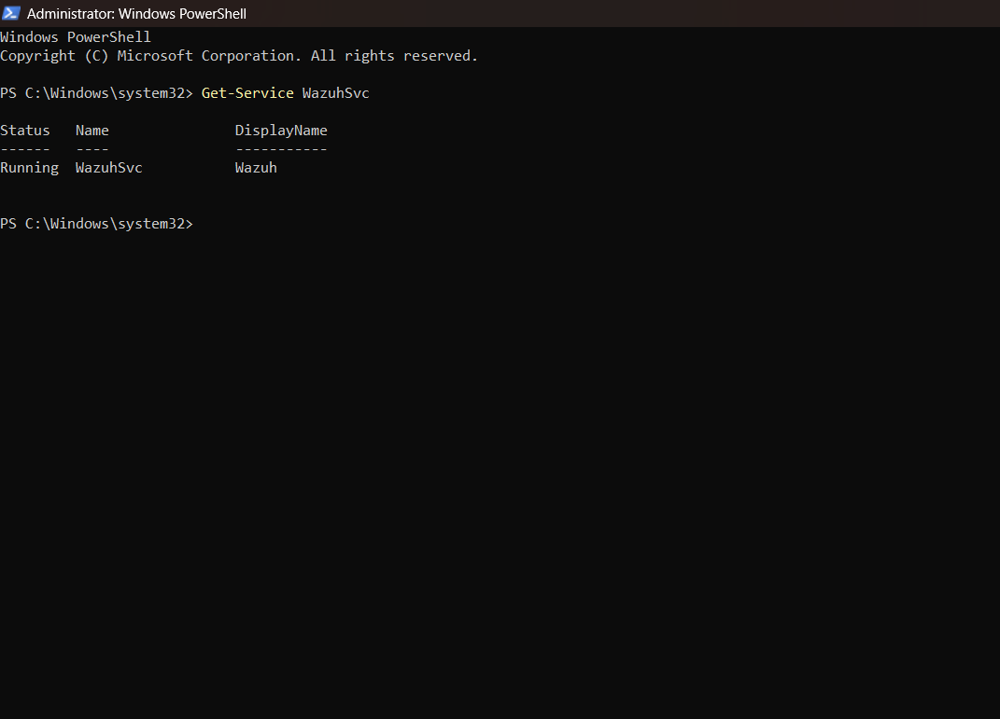

### FIM Test Folder

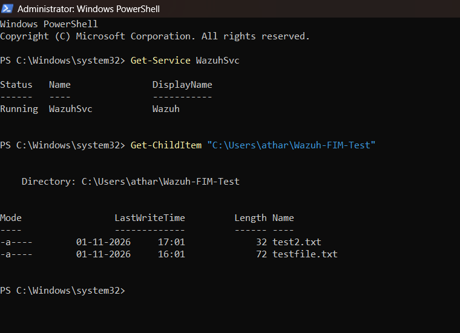

### FIM Configuration

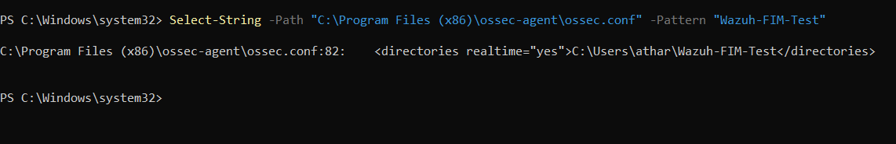

### Test 1 – File Creation

**Windows file creation:**

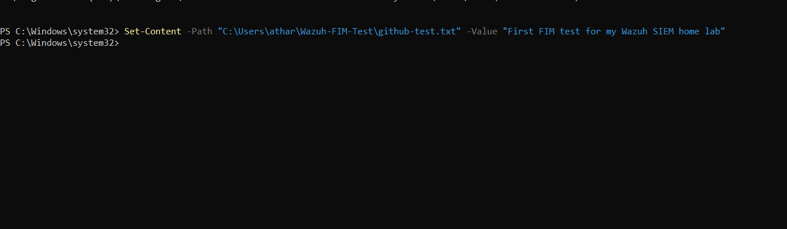

**Wazuh alert:**

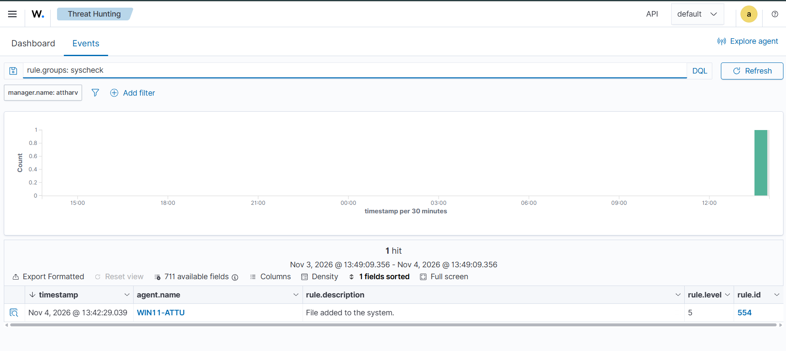

**Event details:**

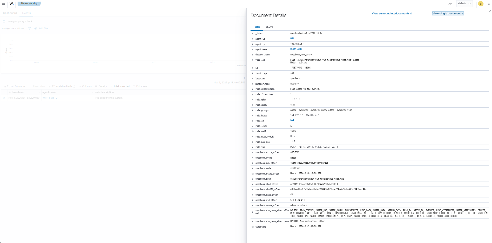

### Test 2 – File Modification

**Windows file modification:**

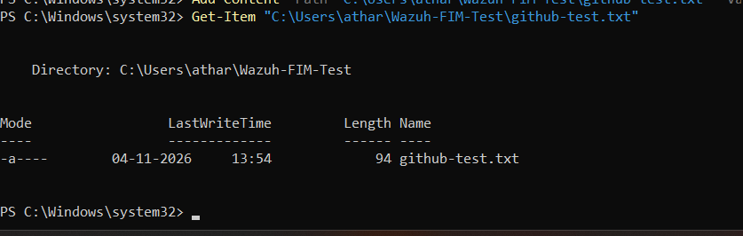

**Wazuh alert:**

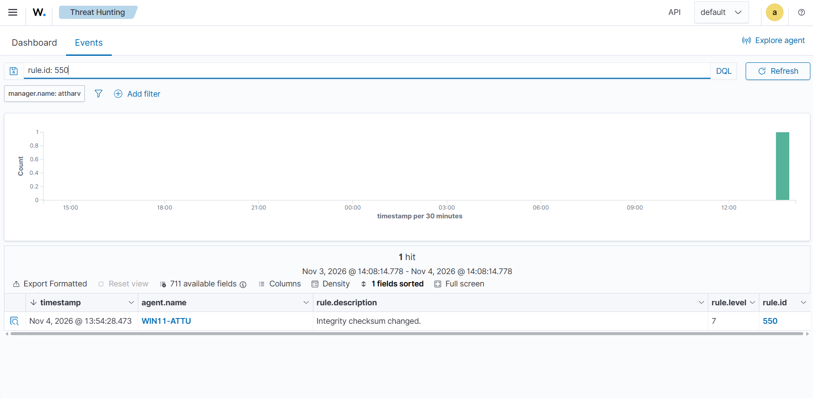

**Event details:**

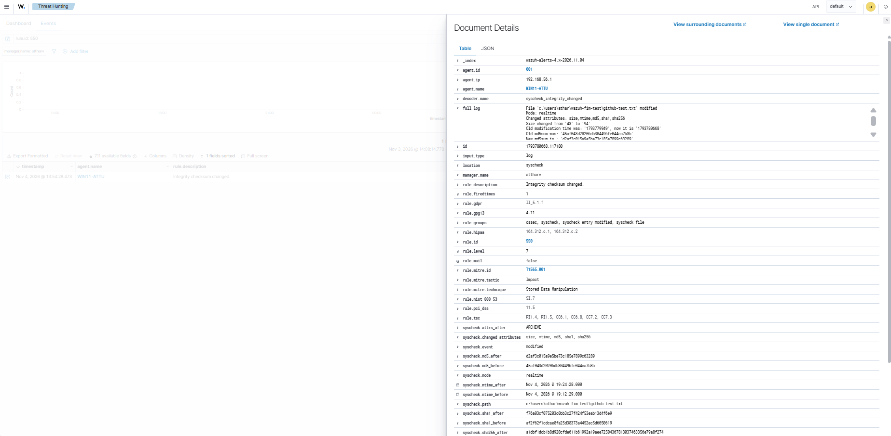

### Test 3 – File Deletion

**Windows file deletion verification:**

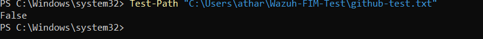

**Wazuh alert:**

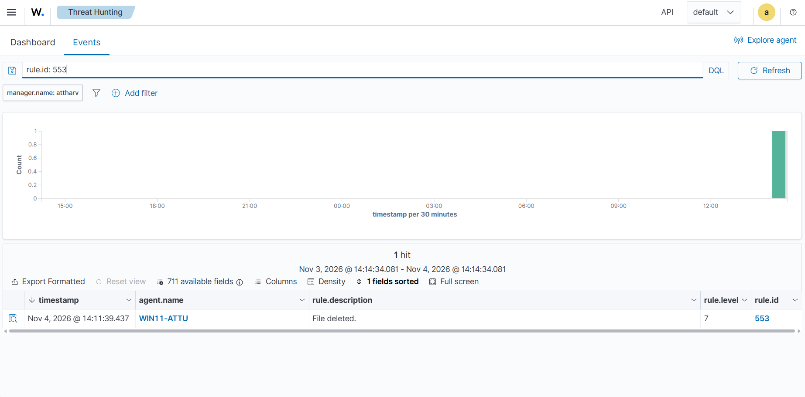

**Event details:**

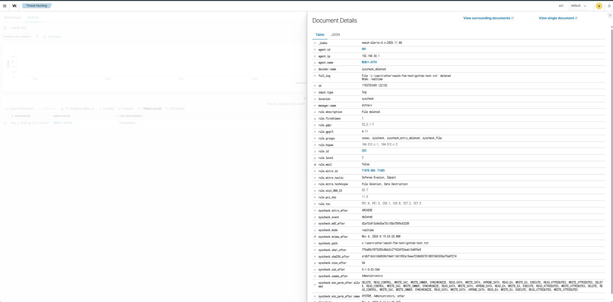

## Key Learnings

- SIEM deployment and configuration.
- Endpoint agent integration.
- Real-time file integrity monitoring.
- Security event investigation.
- Understanding file integrity changes and generated alerts.
- Working with Linux and Windows environments.

## Conclusion

Successfully deployed a Wazuh SIEM home lab and integrated a Windows 11 endpoint for security monitoring. Real-time File Integrity Monitoring was tested, and Wazuh successfully detected file creation, modification and deletion events.

## Author

**Atharva Nhavkar**

- GitHub: [atharvanhavkar1416](https://github.com/atharvanhavkar1416)
- LinkedIn: [Atharva Nhavkar](https://www.linkedin.com/in/atharva-nhavkar-388162315/)
